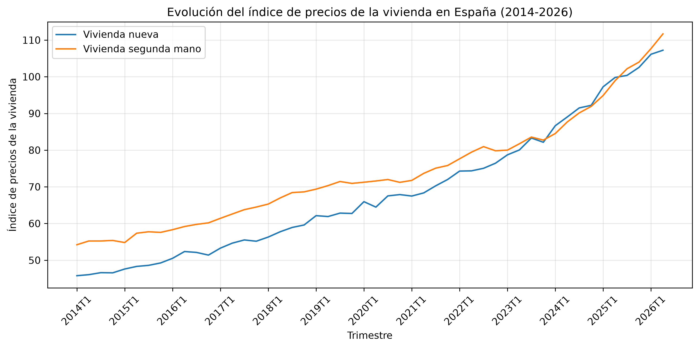

# Análisis exploratorio del Índice de Precios de Vivienda en España (2014–2026)

## Descripción del proyecto

Este proyecto analiza la evolución del Índice de Precios de Vivienda (IPV) en España durante el periodo 2014–2026, a partir de datos oficiales del Instituto Nacional de Estadística (INE).

El análisis se centra en tres aspectos:

- La evolución del índice de precios de la vivienda a nivel nacional.
- Las diferencias entre vivienda nueva y vivienda de segunda mano.
- La comparación de la evolución del IPV en Andalucía, Comunidad de Madrid y Cataluña.

El objetivo es identificar tendencias, cuantificar las variaciones acumuladas y estudiar los periodos de mayor y menor crecimiento interanual.

## Tecnologías utilizadas

- **Python:** procesamiento y análisis de datos.
- **Pandas:** limpieza, filtrado y transformación de datos.
- **Matplotlib:** elaboración de gráficos.
- **Jupyter Notebook:** desarrollo y documentación del análisis.
- **Visual Studio Code:** entorno de trabajo.

## Metodología

El análisis se ha desarrollado siguiendo las siguientes etapas:

1. Importación y exploración inicial del conjunto de datos.
2. Revisión de la estructura, los tipos de datos y los valores ausentes.
3. Conversión de las variables numéricas y selección del periodo de estudio.
4. Análisis de la evolución nacional del IPV.
5. Comparación entre vivienda nueva y vivienda de segunda mano.
6. Análisis comparativo de Andalucía, Madrid y Cataluña.
7. Cálculo de las variaciones acumuladas e interanuales.
8. Visualización e interpretación de los resultados.
## Visualización de los resultados

### Evolución del Índice de Precios de Vivienda en España

El siguiente gráfico muestra la evolución del IPV durante el periodo analizado y permite visualizar su tendencia a lo largo del tiempo.



## Principales resultados

### Evolución regional

Entre el primer trimestre de 2014 y el segundo trimestre de 2026, las tres comunidades analizadas registraron un crecimiento acumulado del IPV.

| Comunidad autónoma | Crecimiento acumulado |
|---|---:|
| Comunidad de Madrid | 138,50 % |
| Cataluña | 118,14 % |
| Andalucía | 108,01 % |

La Comunidad de Madrid presenta el mayor crecimiento relativo del índice durante el periodo estudiado.

### Vivienda nueva frente a vivienda de segunda mano

A nivel nacional, tomando como referencia el segundo trimestre de 2014, se obtuvieron los siguientes resultados:

| Tipo de vivienda | Crecimiento acumulado |
|---|---:|
| Vivienda nueva | 132,82 % |
| Vivienda de segunda mano | 102,18 % |

La vivienda nueva presenta un crecimiento acumulado superior al de la vivienda de segunda mano, con una diferencia de 30,64 puntos porcentuales.

### Variaciones interanuales

El análisis de las tasas interanuales permite identificar periodos de aceleración y desaceleración del crecimiento del índice.

Los máximos observados en las comunidades seleccionadas fueron:

| Comunidad autónoma | Máxima variación interanual | Periodo |
|---|---:|---|
| Andalucía | 14,00 % | 2025T1 |
| Comunidad de Madrid | 14,22 % | 2025T3 |
| Cataluña | 11,65 % | 2025T1 |

## Calidad de los datos

Durante la exploración inicial se identificaron 1.248 valores ausentes en el conjunto de datos original, correspondientes a las categorías de vivienda nueva y vivienda de segunda mano en Ceuta y Melilla.

Las series seleccionadas para el análisis no presentan valores ausentes. Se conservaron los registros originales sin realizar imputaciones.

## Estructura del proyecto

```text
PROYECTO_VIVIENDA_ESPAÑA/
├── data/
│   └── 79563.csv
├── NOTEBOOKS/
│   └── eda.ipynb
└── README.md
```

## Fuente de datos

Instituto Nacional de Estadística (INE).

Conjunto de datos: Índice de Precios de Vivienda (IPV).

El IPV es un indicador de evolución relativa de los precios de compraventa de vivienda, por lo que los resultados no deben interpretarse como precios absolutos expresados en euros.

## Conclusiones

Los resultados muestran un crecimiento sostenido del IPV en el conjunto del periodo analizado, aunque con diferencias relevantes entre territorios y tipos de vivienda.

La Comunidad de Madrid registra el mayor crecimiento acumulado entre las tres comunidades estudiadas, mientras que la vivienda nueva presenta un incremento relativo superior al de la vivienda de segunda mano a nivel nacional.

El proyecto permite aplicar técnicas de preparación, análisis y visualización de datos para interpretar la evolución de un indicador económico oficial.
